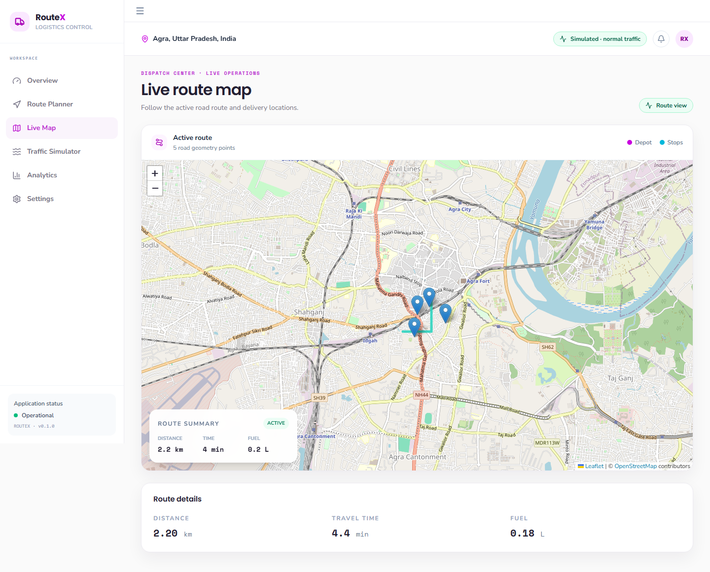
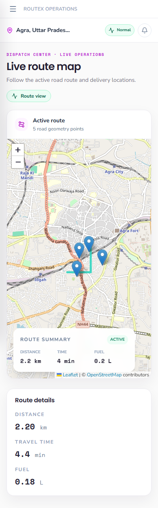

# RouteX

RouteX is an academic single-vehicle delivery-routing application. It combines a Python Ant Colony Optimization (ACO) implementation with road-network costs, simulated congestion, route replanning, and a React operations dashboard.

## Project objective

Demonstrate how a configurable ACO can sequence delivery stops using distance, estimated travel time, and fuel as a normalized multi-objective cost, then replan the uncompleted stops after simulated traffic changes.

## Features

- Route planning for one depot, one vehicle, and numbered delivery stops.
- ACO controls for ant count, alpha, beta, evaporation, iterations, and random seed.
- Configurable distance, time, and fuel objective weights.
- NetworkX directed road paths, nearest-node snapping, and road-following route geometry.
- Agra offline fallback network for reproducible use without OSM service access.
- Simulated normal, moderate, heavy, and severe traffic; congestion affects edge travel time.
- Replanning from the last completed location while excluding completed stops.
- Route history, ACO convergence, scenario comparisons, and fuel estimates from backend results.
- Interactive Leaflet map using OpenStreetMap tiles.
- CSV import for delivery coordinates.

## Architecture and technology

- **Frontend:** React 19, TypeScript, Vite, Tailwind CSS, React Router, React Leaflet/Leaflet, Recharts, Lucide React.
- **Backend:** Python 3.12, FastAPI, Uvicorn, Pydantic.
- **Routing:** custom ACO, NetworkX, OSMnx, NumPy; Pandas is installed as an OSMnx dependency.
- **Traffic:** Python edge-time simulation; a TomTom helper exists but is not connected to graph edges or the optimizer.
- **State:** backend process memory; route history and scenarios reset when the backend restarts.

## Project structure

```text
RouteX/
├── backend/
│   ├── algorithms/       # ACO and route objective
│   ├── api/              # FastAPI endpoints
│   ├── models/           # Pydantic request/response models
│   ├── network/          # OSMnx graph and road-cost matrices
│   ├── optimization/     # Objective and fuel calculations
│   ├── services/         # Route, traffic, and analytics state
│   ├── traffic/          # Simulation and unintegrated TomTom helper
│   ├── utils/
│   └── main.py
├── frontend/
│   ├── src/
│   │   ├── components/
│   │   ├── pages/
│   │   ├── services/
│   │   └── App.tsx
│   ├── tests/            # Playwright browser tests
│   ├── package.json
│   └── vite.config.ts
├── tests/                # pytest unit and integration tests
├── data/sample_locations.csv
├── requirements.txt
├── .env.example
├── .gitignore
└── README.md
```

Previous QA reports and their referenced screenshots are retained at the repository root and under `frontend/qa/`.

## Prerequisites

- Windows 10/11 or another supported Python/Node environment.
- Python 3.12 (the pinned environment was validated with Python 3.12.4).
- Node.js 22+ and npm.
- Internet access for OpenStreetMap map tiles. OSMnx live graph downloads also require internet access.

## Installation

From the project root:

```powershell
py -3.12 -m venv venv
.\venv\Scripts\python.exe -m pip install --upgrade pip
.\venv\Scripts\python.exe -m pip install -r requirements.txt
Copy-Item .env.example .env
Set-Location frontend
npm ci
```

If PowerShell blocks activation, use the interpreter path directly as shown below or enable activation only for the current process:

```powershell
Set-ExecutionPolicy -Scope Process -ExecutionPolicy Bypass
.\venv\Scripts\Activate.ps1
```

## Configuration

The root `.env.example` contains safe local defaults:

```env
VITE_API_URL=http://127.0.0.1:8000
TOMTOM_API_KEY=
```

Vite reads the root `.env` through `frontend/vite.config.ts`; the backend loads it with `python-dotenv`. `TOMTOM_API_KEY` is optional and is not required for simulated traffic. **A configured TomTom key does not enable live route traffic:** flow data is not mapped to graph edges or consumed by the optimizer.

## Run RouteX

Start the backend in Terminal 1:

```powershell
Set-Location D:\RouteX\backend
..\venv\Scripts\python.exe -m uvicorn main:app --reload --host 127.0.0.1 --port 8000
```

Start the frontend in Terminal 2:

```powershell
Set-Location D:\RouteX\frontend
npm run dev
```

Open `http://127.0.0.1:5173`. Check backend readiness at `http://127.0.0.1:8000/api/health`.

The Route Planner currently requests the deterministic **offline-only** network. That fallback graph is for Agra; other cities are rejected rather than being represented by Agra coordinates. The backend API can attempt an OSMnx download with `POST /api/network/load` and `{"city":"...","offline_only":false}`. If that download fails, only the Agra fallback is available.

## How to use

1. Open Route Planner and load the Agra offline fallback network.
2. Set the depot and delivery coordinates, or import a CSV with `latitude` and `longitude` columns.
3. Configure vehicle mileage and (optionally) advanced ACO/objective settings.
4. Choose **Optimize Delivery Route** and review the returned route and metrics.
5. Open Live Map to inspect route geometry and locations.
6. In Traffic Simulator, choose a severity and affected road share; apply changes to replan. Mark deliveries complete before replanning.
7. Review original, active, replanned, normal, and simulated scenario values in Analytics.

Settings currently displays capability information; it does not persist user-editable preferences. The route and analytics state is held in backend memory and is lost on backend restart.

## ACO and route objective

Each ant chooses a reachable next node by roulette sampling with desirability proportional to:

```text
pheromone(i,j)^alpha * (1 / objective_cost(i,j))^beta
```

Pheromone evaporates by the configured rate and is reinforced by candidate tours and the best-so-far tour. A fixed seed makes experiments reproducible. If no feasible tour can be constructed, the backend reports an error instead of returning an invalid route.

The multi-objective cost for a reachable leg is:

```text
cost(i,j) =
  [distance_weight * distance(i,j) / distance_scale
 + time_weight     * time(i,j)     / time_scale
 + fuel_weight     * fuel(i,j)     / fuel_scale]
 / (distance_weight + time_weight + fuel_weight)
```

Scales are the medians of positive finite pairwise matrix values (or 1 when no positive values exist). Route distance, time, and fuel are summed from the selected route’s corresponding leg matrices.

## Traffic and fuel assumptions

Simulated traffic applies severity-dependent speed multipliers to a sample of directed graph edges. It updates travel-time values while leaving road length unchanged. Replanning uses those updated travel times and excludes completed stops.

Fuel is estimated as:

```text
fuel_liters = distance_km * traffic_factor * congestion_multiplier / mileage_km_per_litre
```

The current simulator changes edge travel time, but does not automatically change the fuel factors. Therefore congestion can increase travel time without changing fuel or distance; fuel changes only if the explicit fuel factors or route distance change.

## Tests

Run backend tests from the project root:

```powershell
.\venv\Scripts\python.exe -m pytest -q
```

Run frontend production compilation/build:

```powershell
Set-Location frontend
npm run build
```

For browser tests, start both servers first, then run:

```powershell
Set-Location D:\RouteX\frontend
npm run test:e2e
```

The browser suite covers all six pages and responsive layouts, the route workflow, network-status validation, real OSM tile responses, traffic synchronization, and completed-stop persistence.

## Screenshots





## Known limitations

- The UI uses an Agra-only synthetic offline fallback; its city input does not currently offer an online OSMnx mode.
- Live TomTom-to-road-edge mapping and live-traffic-driven optimization are not implemented.
- OSMnx online graph loading is available through the API, but was not exercised in the final offline reproducibility suite.
- OpenStreetMap tiles require internet connectivity and attribution.
- The fuel model is an estimate based on mileage and explicit traffic factors, not vehicle-specific physics.
- The API keeps all route, traffic, and analytics state in process memory; there is no database or multi-user persistence.
- The frontend production build succeeds but Vite reports a large JavaScript chunk advisory.

## Audit and readiness reports

- [Final system audit](FINAL_SYSTEM_AUDIT.md)
- [Repository cleanup report](CLEANUP_REPORT.md)
- [Browser QA report](BROWSER_QA_REPORT.md)
- [Algorithm audit](ALGORITHM_AUDIT_REPORT.md)
